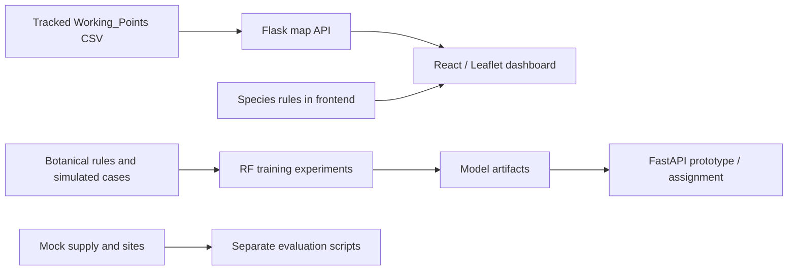

# Optimizing Survival

**A Random Forest-Based Species-Site Suitability Modeling and Weighted Bipartite Matching Spatial Optimization Framework for Community-Led Urban Greening in San Mateo, Rizal**

Undergraduate thesis project (CS 307, Technological Institute of the Philippines – Quezon City). The research explores species-site suitability and spatial decision support for urban greening.

> Research in progress. Existing artifacts and experimental code are preserved. The current React map uses rule-based suitability scoring; separate Python Random Forest and optimization experiments are present, but end-to-end integration and scientific validity are not established by this repository alone.

## Current system

- Interactive San Mateo GIS map with species-first and land-first exploration, campaign settings and site-level suitability explanations.
- Flask map endpoint serving the tracked spatial grid, including soil labels and display bounds.
- Separate Random Forest training and classification experiments using rule-derived simulated training cases.
- Separate Hungarian/weighted bipartite matching experiments and prototype FastAPI planting-event workflow.
- GIS preprocessing and synthetic evaluation scripts.

## Architecture as implemented



The map and experimental Python paths are distinct; there is no asserted live connection between them.

## Run the current dashboard

Preserve the original research environment for experiments. From repository root, use a separate Python environment for the map API:

```powershell
py -3.12 -m venv .venv
.\.venv\Scripts\python.exe -m pip install "Flask>=3,<4" "flask-cors>=5,<7" "pandas>=2,<4"
.\.venv\Scripts\python.exe backend/app.py
```

In another terminal:

```powershell
cd frontend
npm ci
npm run dev
```

Use Node 24 or the version supported by the tracked Vite lockfile. Vite proxies /api to Flask on 127.0.0.1:5000. For a separately hosted frontend, set VITE_API_BASE_URL and set MAP_CORS_ORIGINS on the Flask server to the exact allowed frontend origin. The map requires online map tiles and may use reverse geocoding; the data itself is local. Do not expose the development servers as production services.

## Research reproducibility

The original requirements.txt and npm lockfiles are retained. Do not blindly retrain using either training script: model inputs and artifact filenames differ, and one path uses randomized pH. Do not load pickle files from untrusted sources. Use the original verified research environment and exact corresponding artifacts.

```powershell
.\.venv\Scripts\python.exe scripts/audit_research_baseline.py
.\.venv\Scripts\python.exe -m unittest discover -s tests -v
```

The audit verifies original data, model and scientific script Git blob hashes and prints CSV row counts/headers without modifying files or unpickling models. See [research integrity review](docs/research-integrity.md), [baseline manifest](docs/research-baseline.json), and [CI checks](https://github.com/zed2608/Optimizing-Survival-System/actions). The original data and algorithms are retained; build and integrity tests are not scientific validation.

## Repository map

| Location | Purpose |
| --- | --- |
| frontend/ | React / Vite / Leaflet dashboard |
| backend/app.py | Flask map-data service |
| data/ and root CSVs | Original datasets, mock data and model artifacts |
| api.py, optimization.py, clustering.py | Experimental FastAPI planning and assignment |
| main.py, evaluate_system.py | Separate binary-model simulation workflow |
| train_model.py, train_suitability_model.py | Distinct RF training experiments |
| scripts/audit_research_baseline.py | Read-only artifact integrity checks |
| docs/ | Methodological boundaries and baseline provenance |

## Team

Cyrus Austin G. Andal, Charles Joseph S. Peralta, Ayzhiedy Jee D. Reyes, Angelo Genesis N. Talastas — Technological Institute of the Philippines, Quezon City. Confirm contribution details, municipal-data permissions and adviser-approved claims before public showcase. No field-survival improvement, species-count or accuracy claim is asserted without supporting evidence.
